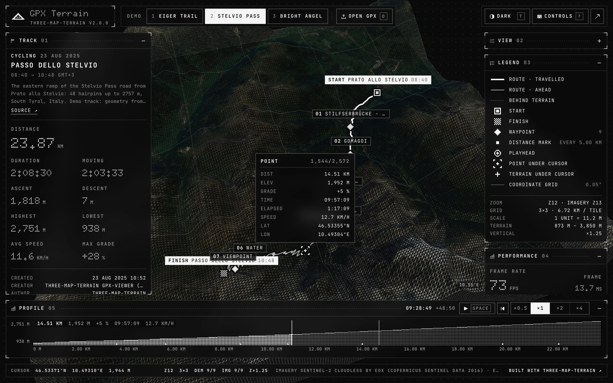
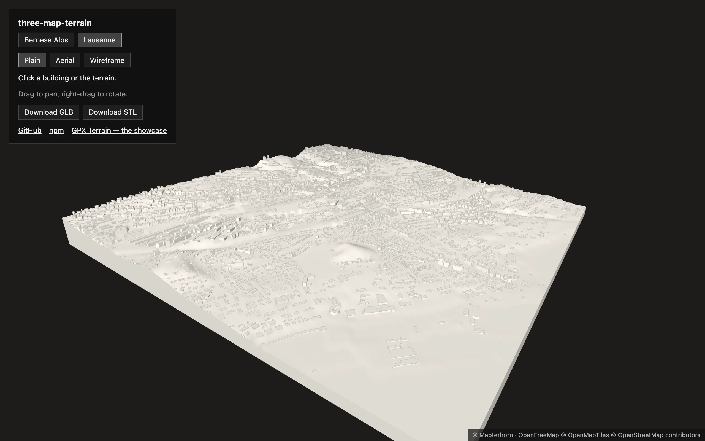
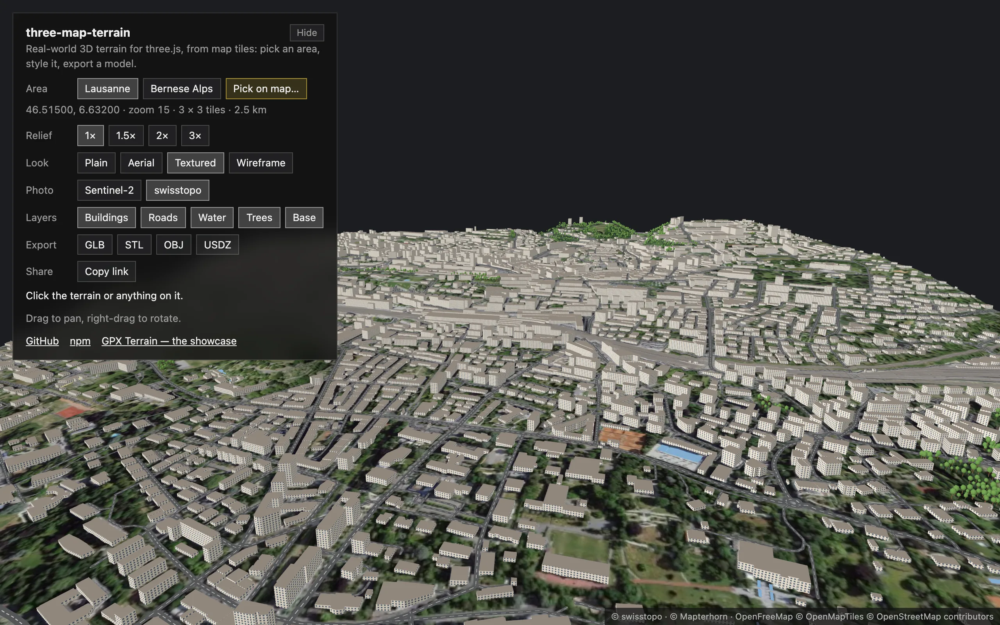
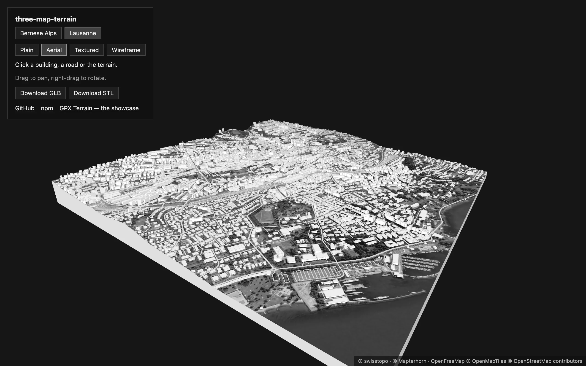
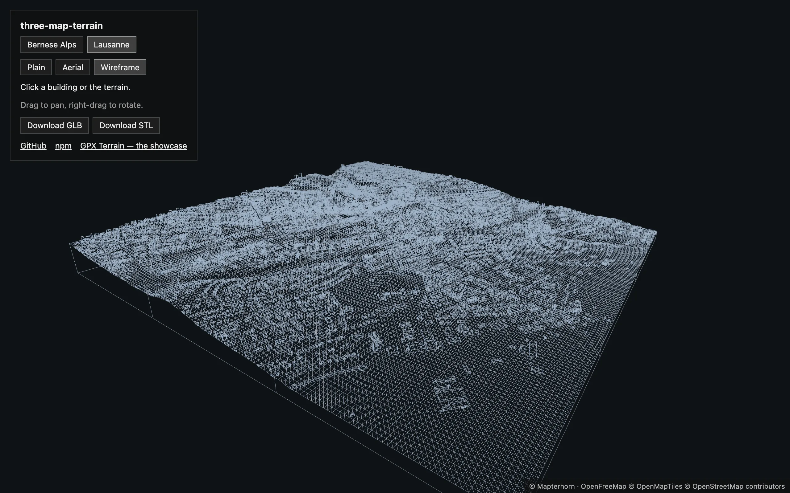
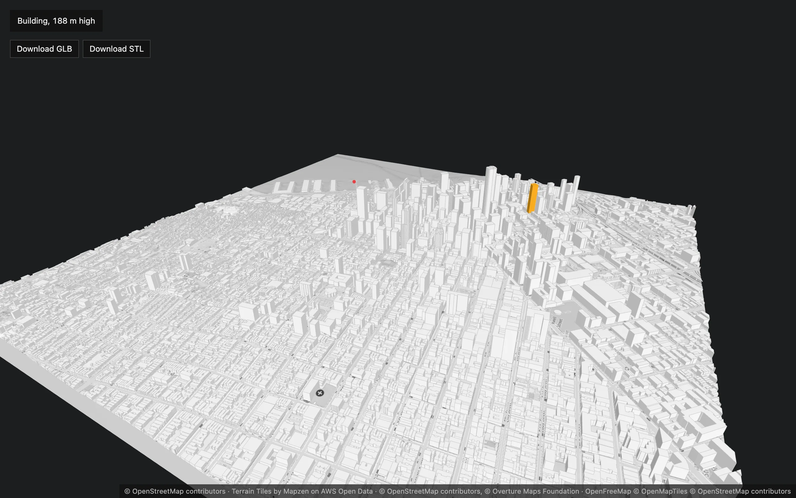

<div align="center">

# three-map-terrain

**Real-world 3D terrain for [three.js](https://threejs.org) from any map tiles — with buildings, roads and bridges, and a frame for your own layers.**<br>
Elevation and imagery from any source, OpenStreetMap buildings standing on the terrain and roads lying exactly on it, the geolocation math to put your data there, and model files — GLB, STL, USDZ — to take it anywhere. Every stage is yours to replace: the data, how it is read, the geometry, the materials.

[](https://www.npmjs.com/package/three-map-terrain)
[](https://github.com/whidrubeld/three-map-terrain/actions/workflows/ci.yml)
[](https://threejs.org)
[](src/index.ts)
[](LICENSE)

[**Live example**](https://whidrubeld.github.io/three-map-terrain/) · [Quick start](#quick-start) · [Layers](#layers) · [Your own layers](#your-own-layers) · [Materials](#materials) · [Sources](#sources) · [API](#api) · [Upgrading](#upgrading)

<a href="https://whidrubeld.github.io/three-map-terrain/"></a>

<table>
  <tr>
    <td width="50%"><a href="https://whidrubeld.github.io/three-map-terrain/?place=lausanne&look=plain"></a></td>
    <td width="50%"><a href="https://whidrubeld.github.io/three-map-terrain/?place=lausanne&look=textured"></a></td>
  </tr>
  <tr>
    <td><a href="https://whidrubeld.github.io/three-map-terrain/?place=lausanne&look=aerial"></a></td>
    <td><a href="https://whidrubeld.github.io/three-map-terrain/?place=lausanne&look=wireframe"></a></td>
  </tr>
</table>

<sub>The live example — [React Three Fiber in one component](examples/react/src/App.tsx): Lausanne from the lake to the cathedral, one map in four looks — plain ([colored](examples/react/src/colored.ts) by part), [textured](examples/react/src/textured.ts) (a few canvas textures on the layers' parts), aerial in grayscale (a `process` of the imagery), wireframe over a light fill.</sub>

</div>

## Features

- **Terrain from real elevation** — [AWS Terrain Tiles](https://registry.opendata.aws/terrain-tiles/), [Mapterhorn](https://mapterhorn.com), Mapbox, MapTiler or your own, at any zoom, as a grid of tiles around a location.
- **Buildings** — OpenStreetMap buildings from [OpenFreeMap](https://openfreemap.org), VersaTiles, MapTiler, Mapbox, Protomaps or the Overpass API, or any data you load ([Overture Maps](https://overturemaps.org) in an example), standing on the rendered terrain.
- **Roads and bridges** — roads and railways lying exactly on the terrain, cut along its triangles; bridges as decks on piers spanning valleys, joined across tiles; tunnels left out.
- **Water and trees** — lakes, the sea and rivers lying on the terrain, islands left land; woods filled with trees (a trunk and a crown, instanced), single trees where they stand.
- **Your own layers** — `FeatureLayer` loads the tiles of any source and keeps your geometry in step with the terrain; `TileContext` drapes polygons and lines on it, extrudes them or places your models. The built-in layers are made of it, and you can replace or extend their geometry.
- **Any look** — every part of a layer takes your material, with UVs in meters so that textures repeat at true size; the terrain takes a material factory (PBR, shaders, node materials) and a `process` for its imagery's pixels. The built-in look — a color, lights, wireframe — is a starting point the layers share.
- **Any source** — every source takes a preset, a `{z}/{x}/{y}` URL template, a TileJSON or your own `load`; a basemap tile is loaded once for all the layers reading it; tiles missing or beyond a source's zoom are cut out of their ancestors.
- **Picking** — the geolocation under the pointer, the building or road there (never one the terrain hides), highlighted over any material.
- **Diorama base and export** — `TerrainBase` closes the terrain into a solid block; GLB, glTF, OBJ, STL (3D printing) or USDZ (AR) of everything, in meters.
- **Seamless while streaming** — tiles are stitched to their neighbours the moment they load, and what lies on them follows: no cracks, no walls, no roads floating or sinking.
- **Plain three.js** — built-in materials, no custom shaders: works with `WebGLRenderer` and `WebGPURenderer`, with lights and fog.
- **Well-behaved** — retries for flaky tile servers, `AbortController` for pending requests, `clean()` frees every GPU resource.
- **Small** — TypeScript, ESM + CommonJS, no runtime dependencies (its own vector tile decoder); `three` is a peer dependency.

## Install

```bash
npm install three three-map-terrain
# or: yarn add three three-map-terrain · pnpm add three three-map-terrain
```

Requires `three` ≥ 0.152.

## Quick start

```ts
import { PerspectiveCamera, Scene, WebGLRenderer } from 'three'
import { MapControls } from 'three/addons/controls/MapControls.js'
import { Map } from 'three-map-terrain'

const scene = new Scene()
const camera = new PerspectiveCamera(60, innerWidth / innerHeight, 1, 1e6)
camera.up.set(0, 0, 1) // the terrain lies in the XY plane, Z is up
camera.position.set(0, -1200, 900)

const renderer = new WebGLRenderer({ antialias: true })
renderer.setSize(innerWidth, innerHeight)
document.body.append(renderer.domElement)
const controls = new MapControls(camera, renderer.domElement)

const map = new Map({
  source: { api: 'eox' }, // Sentinel-2 imagery
  location: { lat: 46.57634, lon: 7.9904 } // Bernese Alps
})
scene.add(map.terrain)
await map.init() // geometry is ready; textures keep streaming in

renderer.setAnimationLoop(() => {
  controls.update()
  renderer.render(scene, camera)
})
```

Built-in materials react to lights: add an `AmbientLight` and a `DirectionalLight`, or pass `material: { lights: false }`.

### React Three Fiber

```tsx
import { MapControls } from '@react-three/drei'
import { Canvas } from '@react-three/fiber'
import { useEffect, useMemo } from 'react'
import { Map } from 'three-map-terrain'

export function Terrain() {
  const map = useMemo(
    () =>
      new Map({
        source: { api: 'eox' },
        location: { lat: 46.57634, lon: 7.9904 }
      }),
    []
  )

  useEffect(() => {
    void map.init()
    return () => map.clean() // aborts requests, frees GPU memory
  }, [map])

  return <primitive object={map.terrain} />
}

export default function App() {
  return (
    <Canvas camera={{ up: [0, 0, 1], position: [0, -1200, 900], far: 1e6 }}>
      <ambientLight intensity={1.5} />
      <directionalLight position={[-1e4, 1e4, 1e4]} intensity={2.5} />
      <Terrain />
      <MapControls />
    </Canvas>
  )
}
```

### Put things on the map

```ts
// on the rendered surface, wherever the terrain is
const { x, y, z } = await map.getTerrainPosition({ lat: 46.6242, lon: 8.0414 })
marker.position.set(x, y, z)

// every frame, for moving objects (undefined until that tile has loaded)
const p = map.getTerrainPositionSync({ lat, lon })
if (p) vehicle.position.set(p.x, p.y, p.z)

// at an altitude in meters, e.g. an aircraft
const { x, y, z } = map.getPosition({ lat, lon, alt: 3000 })

// the geolocation under the pointer
raycaster.setFromCamera(pointer, camera)
const hit = map.pick(raycaster) // { lat, lon, alt, point } | undefined
```

## Layers

Buildings, roads, water, trees and the base are layers of the map: they follow its tiles as they load, take on its look and go into its exports. They need a city-scale zoom — 14 to 16; at 15 a 3 × 3 grid is about 2.5 km wide — and true scale, so that they are not flattened:

```ts
import {
  Buildings,
  Map,
  Roads,
  TerrainBase,
  Trees,
  Water
} from 'three-map-terrain'

const map = new Map({
  location: { lat: 46.515, lon: 6.632 }, // Lausanne
  elevation: { api: 'mapterhorn' },
  options: {
    zoom: 15,
    exaggeration: 1, // true to scale: heights as wide as they are high
    baseAltitude: 372 // Lake Geneva at z = 0: the scene stays near the origin
  }
})
// all read the OpenFreeMap tiles, loaded once
const buildings = map.addLayer(
  new Buildings({ source: { api: 'openfreemap' }, edges: true })
)
const roads = map.addLayer(new Roads({ source: { api: 'openfreemap' } }))
const water = map.addLayer(new Water({ source: { api: 'openfreemap' } }))
// not in the river, on the roads or in the houses a wood of the data takes in
map.addLayer(
  new Trees({
    source: { api: 'openfreemap' },
    avoid: [water, roads, buildings]
  })
)
map.addLayer(new TerrainBase()) // a solid block
scene.add(map.terrain) // the layers are in map.terrain too
await map.init()

// the building or road under the pointer, highlighted
raycaster.setFromCamera(pointer, camera)
const hit = buildings.pick(raycaster) ?? roads.pick(raycaster) // { feature, lat, lon, alt, point }
buildings.highlight(hit?.feature)
```

With React Three Fiber, a pointer event is already an intersection: `buildings.pickIntersection(event)`; roads, which lie on the terrain, are picked with the event's ray: `roads.pick(new Raycaster(event.ray.origin, event.ray.direction))`.

Layers draw their tiles a few at a time between frames, across every layer — so that the data arriving at once never holds up a frame — the nearest to `map.focus` first: by default the location, or a point you keep, in world coordinates:

```ts
map.focus = camera.position // or controls.target: followed as it moves
```

### Buildings

- **On the surface.** Walls start just below the lowest ground under them; the roof is `height` meters above it — and at least 3 m above the highest ground on a slope. Heights are scaled like the terrain. Parts with a `minHeight` (overhangs, towers on podiums) float with a floor; courtyards stay open. Roofs are flat.
- **Once, whole.** A building is drawn by the terrain tile its center lies in, so one crossing a tile border is drawn once and never cut. Sources whose tiles are coarser than the terrain (most stop at zoom 14) are loaded once for the terrain tiles they cover.
- **Cut at the edge.** With `clip` (default) buildings end with the grid: those crossing its edge are cut along it, and the parts of buildings outside that reach in are drawn — a clean section on a `TerrainBase`.
- **Data.** Heights, minimum heights and colors come from the source: OSM `height`, `building:levels` (3 m each), `min_height`, `building:colour`; vector tiles with these precomputed. Outlines that have `building:part`s are left to the parts. Buildings without a height get `defaultHeight`.
- **Parts.** Every tile has a mesh of `walls` (UVs in meters along and up), `roofs`, `floors` and the `edges` (lines, with `edges` or in wireframe) — each can have [its own material](#materials).

### Roads and bridges

- **On the surface.** Every terrain tile draws the part of the roads in it as ribbons cut along the terrain's triangles, so they lie exactly on the rendered surface and are lit like it; they are drawn with a polygon offset to stay in front of it. When a neighbouring tile loads and the seams between them are stitched, the roads near the seam follow.
- **Widths.** By kind — `motorway` 11 m (one carriageway), `trunk` 10, `primary` 9, `secondary` 8, `tertiary` 7, `minor` 5.5, `service` 3.5, `track` 3, `path` 2, `rail` 3 (`ROAD_WIDTHS`); links 0.6 of that; OSM `width` or `lanes` where the source has them. `widths` overrides them, `kinds` chooses which are drawn.
- **Bridges** are decks at their own height. Their pieces from different tiles are joined (by `id`, or end to end where nothing else meets: a viaduct mapped as several roads), and the deck is stretched over the ground between its ends — the upper hull of the terrain under it: never below the ground, no dips. Where the elevation has no embankments (an overpass on coarse data) a bridge clearing nothing rises to 5 m from its ends. Piers stand every 40 m where the deck is 3 m or more above the ground. `bridges: false` lays them on the terrain like the other roads.
- **Tunnels** are not drawn.
- **Parts.** `surface` (roads), `rails` (railways), `deck` (the top of bridges), `structure` (their sides, bottom and piers), `lines` (center lines and outlines, shown in wireframe). Roads and decks have UVs across (0 to 1) and along (meters): a texture with markings repeats along them.

### Water

- **On the surface**, like roads: areas — lakes, the sea, rivers, ponds, pools — are cut along the terrain's triangles; their holes, islands, stay land. Waterways (rivers, canals, streams, ditches) are ribbons as wide as their kind (`WATERWAY_WIDTHS`: river 12 m, canal 8, stream 2.5, ditch 1.5; `widths` overrides them) or the source says. They are drawn in front of the terrain and behind the roads. Waterways in tunnels are not drawn.
- **Parts.** `water` (blue, `WATER_COLOR`, unless the look gives a color), `lines` (shores and center lines, in wireframe).

### Trees

- **Woods** — `landcover` `wood` from the basemaps, `natural=wood` and `landuse=forest` from Overpass — are filled with trees on a grid of `spacing` meters (default 9), jittered: anchored to the map, so that they never move when a tile is drawn again and never double at tile edges. **Single trees** (points: `natural=tree`, or yours) stand where they are.
- **Clear ground.** Woods in the data are coarse areas: they take in the rivers, roads and houses crossing them. `avoid` lists the layers whose ground stays clear of trees — water, roads, buildings, yours: a tree stands only where none of them drew, at least `clearance` meters (default 2) from it. A tile's trees are planted once those layers have drawn it and its neighbours; when one of them draws a tile again later, the trees there are planted again.
- **A tree** is a trunk and a crown — a prism and an ellipsoid, 8 and 20 triangles, the crown shaded round — standing on the rendered surface, `height` meters high (from the source, or between `heights`, default 8–16 m). They are copies of one geometry each, an `InstancedMesh` per tile (at most `maxPerTile`, default 12 000): picking returns the tree or its wood, `highlight()` draws its copies over them; in wireframe they are outlined. Models without instancing (STL, OBJ, USDZ) get every copy.
- **Fewer on a wide map.** `spacing` can be a function of the terrain's zoom: `spacing: (zoom) => (zoom < 15 ? 14 : 9)`.
- **Parts.** `crowns` (green, `CROWN_COLOR`, unless the look gives a color), `trunks` (brown) — in their materials' colors: `trees.setMaterial({ color: '#8a8a8a' })` or materials of yours recolor them in place. Trees need a zoom of 14 or more (`minZoom`).

### Diorama base

`TerrainBase` closes the terrain into a solid block — side walls from its outer edges down to `depth` meters below its lowest point, and a bottom — for a cut-out of the world, and a closed model to print. In wireframe it is drawn as its outline.

## Your own layers

`FeatureLayer` is what `Buildings` and `Roads` are made of: give it a source of features and a `build` that draws a terrain tile; it loads the source's tiles (shared, cancelled when unused), draws every tile when its features arrive, and again when the heights it read change. What you draw goes into named parts — one object per part and tile, each with [its material](#materials) — and what you wrap in `ctx.feature()` can be picked and highlighted.

```ts
import { Color, Group } from 'three'
import { FeatureLayer } from 'three-map-terrain'

interface Tree {
  id: number
  position: [lon: number, lat: number]
  height: number
}

const trees = map.addLayer(
  new FeatureLayer<Tree>({
    name: 'trees',
    source: {
      minZoom: 15,
      maxZoom: 15,
      attribution: '© My city',
      load: async ({ z, x, y, signal }) =>
        (await fetch(`/trees/${z}/${x}/${y}.json`, { signal })).json()
    },
    build(ctx) {
      const [minX, minY, maxX, maxY] = ctx.rect
      for (const tree of ctx.allFeatures) {
        const [x, y] = ctx.toLocal(tree.position)
        if (x < minX || x >= maxX || y < minY || y >= maxY) continue // another tile's
        ctx.feature(tree, () => {
          const model = treeModel.clone() // any Object3D, in the tile's coordinates
          model.position.set(x, y, ctx.groundAt(x, y))
          model.scale.setScalar(tree.height * ctx.zScale)
          ctx.add(model)
        })
      }
    }
  })
)

trees.pick(raycaster)?.feature // the Tree under the pointer
```

`TileContext` — the `ctx` — has the tile's features and the primitives that put geometry on the terrain, in the tile's local coordinates (scene units, x east, y north):

| Primitive                                       | Draws                                                                                                                                      |
| ----------------------------------------------- | ------------------------------------------------------------------------------------------------------------------------------------------ |
| `drapePolygon(part, rings, { color, clip })`    | A polygon with holes lying on the terrain: water, parks, fields — cut along the terrain's triangles, lit like it                           |
| `drapeLine(part, line, width, { color })`       | A ribbon lying on the terrain, with round caps; UVs across and along in meters                                                             |
| `drapePath(part, line, { color })`              | A line lying on the terrain (lines are built only if their part's material is visible)                                                     |
| `extrude(polygons, bottom, top, style)`         | Walls, a roof and a floor (`floor`), and their edges — into the parts `walls`, `roofs`, `floors`, `edges` or the `parts` you name          |
| `face(part, points, { color, normal, uv })`     | Any planar convex polygon `[x, y, z, …]`, turned to face `normal`                                                                          |
| `segment(part, a, b, color)`                    | A line from `[x, y, z]` to `[x, y, z]`                                                                                                     |
| `instances(part, geometry).add(matrix, color?)` | Copies of a shared geometry — trees, lamps — one `InstancedMesh` per part and tile, each copy picked as its feature, outlined in wireframe |
| `add(object)`                                   | Any object — a model, an `InstancedMesh`; picked as the feature being drawn                                                                |

And what they are made of: `toLocal([lon, lat])`, `groundAt(x, y)` (the rendered surface, also in loaded neighbours), `surfaceAt(x, y)` (height and normal, `undefined` where not loaded), `unitsPerMeter`, `zScale`, `rect` (the tile), `sources` (the features by source tile, with its `rect`), `planarUv(x, y)`, `visible(part, kind?)` (whether a part's material shows: skip drawing what it hides — the tile is drawn again once it shows), and the raw `surface(part)` / `lines(part)` builders. Heights read through `ctx` are tracked: the tile is drawn again when they change.

The built-in layers take a `build` too, which receives their own drawing as `draw(features?)` — replace the geometry of some features, keep it for the others:

```ts
new Buildings({
  source: { api: 'openfreemap' },
  build(ctx, draw) {
    // your models for some buildings, the extrusion for the rest
    draw(ctx.allFeatures.filter((building) => !models.has(building.id)))
    for (const building of ctx.allFeatures) {
      const model = models.get(building.id)
      if (!model) continue
      ctx.feature(building, () => {
        const [x, y] = ctx.toLocal(anchorOf(building))
        model.position.set(x, y, ctx.groundAt(x, y))
        ctx.add(model)
      })
    }
  }
})
```

Subclass `FeatureLayer` for a reusable layer: override `draw(ctx, features)` (and `select()` to decide which tile draws a feature crossing tiles, `partColor()` / `createMaterial()` for its look — colors in the materials, so that a new look only changes them — `sourceLoaded()` / `prepare()` for what spans tiles — `Roads` joins its bridges there — and `canDraw(tile)` to wait for other layers, as `Trees` waits for `avoid`). `FeatureLayer` is new in 3.0: its API may still grow.

Underneath is `MapLayer`, the interface the map talks to; implement it for anything that is not tile features — every method is optional:

```ts
map.addLayer({
  attribution: '© My data', // listed in map.attributions
  attach(map) {}, // added: map.terrain is there to add objects to
  tileLoaded(tile) {}, // a tile is in the scene: tile.heightAt(u, v), tile.mesh.position
  tileChanged(tile) {}, // its heights changed: a neighbour loaded and the seams were stitched
  tileRemoved(tile) {}, // free what you made for it
  materialChanged(map) {}, // map.setMaterial(): follow map.materialOptions
  whenReady: async () => {}, // map.whenReady() and map.export() wait for it
  detach(map) {} // map.removeLayer()
})
```

## Materials

The library draws with three.js' built-in materials from a few options — the look — and lets you replace any of them.

**The look** — `lights`, `wireframe`, `fillOpacity`, `fog`, `color` — is shared: the terrain's (the map's `material`) is the default of every layer, which can override it.

```ts
// no imagery: a plain model, the relief shows in the light; the layers too
new Map({ location, material: { color: '#f2ede5' } })

// everything in lines: the terrain's triangles, the buildings' edges, the
// roads' center lines, the trees' outlines — over a light fill of the faces
new Map({
  location,
  material: { wireframe: true, fillOpacity: 0.12, color: '#9fb3c8' }
})
```

**The imagery's pixels** — `process` draws on a tile's stitched imagery before it becomes a texture: tone it, blend in a hillshade, render your own data into it. It runs on the CPU, the same in every browser, and goes into exported models:

```ts
import { type ImageryProcessor } from 'three-map-terrain'

const gray: ImageryProcessor = (context, { width, height }) => {
  const image = context.getImageData(0, 0, width, height)
  const { data } = image
  for (let i = 0; i < data.length; i += 4) {
    const luma = 0.2126 * data[i] + 0.7152 * data[i + 1] + 0.0722 * data[i + 2]
    data[i] = data[i + 1] = data[i + 2] = luma
  }
  context.putImageData(image, 0, 0)
}
new Map({ source: { api: 'osm' }, location, material: { process: gray } })
```

**The terrain's material** — `create` makes it from the tile's imagery: any material, PBR maps, a `ShaderMaterial`, a node material for `WebGPURenderer`. It is called for every texture and every `setMaterial()`; the tile owns the imagery texture, the material is the tile's:

```ts
new Map({
  source: { api: 'eox' },
  location,
  material: {
    create: ({ texture }) =>
      new MeshStandardMaterial({ map: texture, roughness: 0.95 })
  }
})
```

`createTerrainMaterial({ texture, options })` is the built-in one, to wrap or start from.

**A layer's materials** — one for all its faces, or one per part (a function returning `undefined` keeps the look's for that part). Materials you pass are yours: the layer never disposes them.

```ts
const asphalt = new TextureLoader().load('asphalt.jpg') // markings along v
asphalt.wrapS = asphalt.wrapT = RepeatWrapping
asphalt.repeat.set(1, 1 / 10) // once across, a cycle every 10 m along
const road = new MeshStandardMaterial({
  map: asphalt,
  // draped on the terrain: drawn in front of it
  polygonOffset: true,
  polygonOffsetFactor: -1,
  polygonOffsetUnits: -4
})

new Roads({
  source: { api: 'openfreemap' },
  material: (part) => (part === 'surface' ? road : undefined)
})
```

UVs are in meters, so textures repeat at true size:

| Geometry                                           | `u`                                  | `v`            |
| -------------------------------------------------- | ------------------------------------ | -------------- |
| Roads, railways, waterways, decks, `drapeLine`     | across, from 0 (left) to 1 (right)   | along, meters  |
| Walls (`extrude`)                                  | along the wall, meters               | up, meters     |
| Roofs, floors, water, `drapePolygon`, flat `face`s | east, meters (continuous over tiles) | north, meters  |
| Other `face`s                                      | along its first edge, meters         | across, meters |
| The terrain                                        | its imagery (0–1 over the tile)      | —              |

The built-in materials have the look's colors — each part its own shade — and multiply the vertex colors, white but where colors differ by feature (`featureColors`). Every vertex also has `featureIndex`, the index of its feature, for your shaders. `highlight()` draws over the highlighted features with a material of its own, so it works with any of yours.

Change the look at runtime — the textures are kept, the layers' materials change in place, their geometry stays, and a material function is asked again:

```ts
map.setSource({ api: 'none' }) // imagery off; or another source
map.setMaterial({ wireframe: true }) // only a new `process` reloads imagery

// a layer's own look, merged into it; a material or a function replaces it
buildings.setMaterial({ color: '#d8d4cc' })
roads.setMaterial((part) => (part === 'surface' ? road : undefined))
water.setMaterial(undefined) // the map's look again
```

Only what a hidden material left out — lines out of wireframe, copies of a hidden part — is drawn when it shows, a few tiles at a time.

The live example's looks are all made this way: aerial and wireframe from the options and a `process` ([App.tsx](examples/react/src/App.tsx)), plain from [a color per part](examples/react/src/colored.ts), textured from [a few canvas textures on the parts](examples/react/src/textured.ts) — and a part hidden where the photo has it already (`new MeshBasicMaterial({ visible: false })`).

## Export

```ts
const blob = await map.export('glb') // 'glb' | 'gltf' | 'obj' | 'stl' | 'usdz'

const link = document.createElement('a')
link.href = URL.createObjectURL(blob)
link.download = 'lausanne.glb'
link.click()
```

`map.export()` waits for everything to be loaded, then writes the terrain with its imagery and every layer in meters — true to scale horizontally, heights with the map's exaggeration. glTF, OBJ and USDZ are Y-up as their tools expect, STL stays Z-up for slicers; with a `TerrainBase` the terrain is a solid block, and the buildings stand in it — what a slicer needs to print a city. Materials become `MeshStandardMaterial`s with their color, texture and vertex colors; highlights are left out. Roads lie flush on the terrain: in a model without polygon offsets they may flicker, and for printing they add nothing — leave them out with `layers: false` or remove the layer first. Options: `textures`, `lines` (edges), `layers`, `units: 'scene'`. For any other three.js object there is `exportModel(object, format, options)`. three.js' exporters are loaded only when you export.

## Sources

Every kind of source takes a preset `api`, a URL template or your own `load` function, and `maxZoom` / `attribution`. A tile that is missing (HTTP 404, or a `load` resolving to `null`) or deeper than `maxZoom` is cut out of its nearest ancestor, so terrain deeper than a source still works.

### Imagery — `source`

| `api`      | Imagery                                                                        | Key |
| ---------- | ------------------------------------------------------------------------------ | --- |
| `eox`      | [Sentinel-2 cloudless](https://s2maps.eu) satellite mosaic                     | —   |
| `osm`      | [OpenStreetMap](https://www.openstreetmap.org) standard map                    | —   |
| `mapbox`   | Mapbox satellite                                                               | yes |
| `maptiler` | MapTiler satellite                                                             | yes |
| `none`     | No imagery: the terrain is drawn in `material.color` (also without a `source`) | —   |

Any other tile server by its URL — `{z}`, `{x}`, `{y}`, `{-y}` (TMS), `{s}` (subdomains), `{quadkey}`:

```ts
// swisstopo aerial imagery, 10 cm in Switzerland
{ url: 'https://wmts.geo.admin.ch/1.0.0/ch.swisstopo.swissimage/default/current/3857/{z}/{x}/{y}.jpeg', maxZoom: 20, attribution: '© swisstopo' }
// Esri World Imagery: rows before columns
{ url: 'https://server.arcgisonline.com/ArcGIS/rest/services/World_Imagery/MapServer/tile/{z}/{y}/{x}', attribution: 'Esri, Maxar, Earthstar Geographics' }
// your own loader: headers, WMS, a cache, local files — an image, canvas or bitmap
{ load: async ({ z, x, y, signal }) => myImage(z, x, y, signal) }
```

Hundreds of templates with their attributions are listed by [leaflet-providers](https://github.com/leaflet-extras/leaflet-providers) and [xyzservices](https://github.com/geopandas/xyzservices); the [Editor Layer Index](https://github.com/osmlab/editor-layer-index) has aerial imagery by country — mind that much of it is licensed for editing OpenStreetMap only.

### Elevation — `elevation`

| `api`           | Data                                                                                                                                   | Key |
| --------------- | -------------------------------------------------------------------------------------------------------------------------------------- | --- |
| `aws` (default) | [AWS Terrain Tiles](https://registry.opendata.aws/terrain-tiles/), terrarium, to zoom 15                                               | —   |
| `mapterhorn`    | [Mapterhorn](https://mapterhorn.com), terrarium, 512 px; 30 m worldwide, much finer where open data exists (e.g. Switzerland, Austria) | —   |
| `mapbox`        | Mapbox Terrain-RGB, to zoom 15                                                                                                         | yes |
| `maptiler`      | MapTiler Terrain RGB, to zoom 14                                                                                                       | yes |

Any other server by its URL with its `encoding` — `'terrarium'`, `'mapbox'` or a function `(r, g, b) => meters` — or a `load` returning RGBA pixels (e.g. decoded from a GeoTIFF).

### Buildings, roads, water, trees — a provider read through a schema

A layer's features come from a **provider** — a basemap's vector tiles, Overpass, your `load` — read through the layer's **schema**: which layers of the tiles hold its features and how their fields become attributes. The layers know the schemas of the basemaps:

| `api`         | Vector tiles                                                                                                                                                       | Key | Buildings: zooms, heights       | Roads, water, trees: zooms |
| ------------- | ------------------------------------------------------------------------------------------------------------------------------------------------------------------ | --- | ------------------------------- | -------------------------- |
| `openfreemap` | [OpenFreeMap](https://openfreemap.org) (OpenMapTiles)                                                                                                              | —   | 13–14, from OSM tags            | 12, 10, 12 – 14            |
| `versatiles`  | [VersaTiles](https://versatiles.org) (Shortbread)                                                                                                                  | —   | 14, none: `defaultHeight`       | 12, 10, 12 – 14            |
| `maptiler`    | MapTiler (OpenMapTiles)                                                                                                                                            | yes | 13–14, from OSM tags            | 12, 10, 12 – 14            |
| `mapbox`      | Mapbox Streets v8                                                                                                                                                  | yes | 15–16, `height`, `min_height`   | 12, 10, 12 – 16            |
| `protomaps`   | Protomaps basemap                                                                                                                                                  | yes | 14–15, `height`, `min_height`   | 12, 10, 12 – 15            |
| `overpass`    | OpenStreetMap through the [Overpass API](https://overpass-api.de) — every tag; slow (tens of seconds a tile), one request at a time; `endpoint` for another server | —   | 14, `height`, `building:levels` | 14 (single trees too)      |

Layers using the same preset share its tiles: a basemap tile is loaded and decoded once, and cancelled only when no layer needs it. To share your own tiles the same way, give the layers one `VectorTiles`:

```ts
const tiles = new VectorTiles({
  url: 'https://my.server/{z}/{x}/{y}.pbf',
  schema: 'openmaptiles'
})
new Buildings({ source: { tiles } })
new Roads({ source: { tiles } })
```

Any vector tile (MVT) server by its `url` or `tilejson`, with the `layers` that hold the features and a `properties` function reading them — the schemas of OpenMapTiles, Mapbox Streets, Protomaps, Shortbread and Overture come with the library:

```ts
new BuildingSource({ tilejson: 'https://my.tileserver/data/v3.json' }) // OpenMapTiles fields by default
new BuildingSource({
  url: 'https://my.server/{z}/{x}/{y}.pbf',
  layers: 'buildings',
  properties: (p) => ({ height: Number(p.h), hidden: p.underground === true })
})
new RoadSource({
  url: 'https://my.server/{z}/{x}/{y}.pbf',
  layers: 'ways',
  properties: (p) => ({ kind: roadKind(p.type), bridge: p.bridge === 1 })
})
```

Or anything else with `load`: return the features of a tile — buildings as GeoJSON-like polygons, whole (each is drawn by the tile its center is in) or clipped to the tile; roads as lines, whole or clipped (pieces of a bridge with the same `id` are joined):

```ts
new BuildingSource({
  minZoom: 15,
  maxZoom: 15,
  attribution: '© My city',
  async load({ z, x, y, signal }) {
    const response = await fetch(
      `https://my.server/buildings/${z}/${x}/${y}.geojson`,
      { signal }
    )
    const { features } = await response.json()
    return features.map((f) => ({
      id: f.id,
      geometry: f.geometry,
      height: f.properties.height,
      properties: f.properties
    }))
  }
})
```

The [basic example](examples/basic/src/overture.ts) loads the [Overture Maps](https://overturemaps.org) buildings — OpenStreetMap merged with Microsoft, Google and Esri footprints — from their PMTiles archive this way, in a few lines. Your own layers take any `FeatureSource` — an object with `minZoom`, `maxZoom`, `attribution` and `load(tile)` — or a `TileFeatureSource` with a schema of your own.

## Examples

| Example                                                      | Stack                         | What it shows                                                                                                                                                                                                                                                                    |
| ------------------------------------------------------------ | ----------------------------- | -------------------------------------------------------------------------------------------------------------------------------------------------------------------------------------------------------------------------------------------------------------------------------- |
| [React](examples/react)                                      | React Three Fiber, drei, Vite | The [live example](https://whidrubeld.github.io/three-map-terrain/): the Alps with imagery; Lausanne with buildings, roads and bridges, water, trees and a base in four looks switched at runtime — one colored by part, one textured; picking, highlighting, GLB and STL export |
| [Basic](examples/basic)                                      | three.js, webpack             | San Francisco: Overture buildings from a custom PMTiles source and OpenFreeMap roads on a toned-down map, a base, picking, export                                                                                                                                                |
| [**GPX Terrain**](https://github.com/whidrubeld/gpx-terrain) | React, R3F, TanStack Store    | [A full app](https://whidrubeld.github.io/gpx-terrain/) on the library: GPX tracks draped on terrain, profile, playback, picking, imagery and wireframe at runtime                                                                                                               |

<table>
  <tr>
    <td width="50%"><a href="examples/basic"></a></td>
    <td width="50%"><a href="https://whidrubeld.github.io/gpx-terrain/"></a></td>
  </tr>
  <tr>
    <td><sub>Basic: San Francisco with Overture buildings and roads</sub></td>
    <td><sub>GPX Terrain: a GPX viewer built with the library</sub></td>
  </tr>
</table>

## API

### `new Map({ location, source?, elevation?, options?, material? })`

| Prop        | Type                                      | Description                                              |
| ----------- | ----------------------------------------- | -------------------------------------------------------- |
| `location`  | `{ lat: number; lon: number }`            | The grid is centered on the tile containing it           |
| `source`    | `Source \| SourceProps`                   | Imagery; [see above](#imagery--source). Without it, none |
| `elevation` | `ElevationSource \| ElevationSourceProps` | Elevation; AWS Terrain Tiles by default                  |
| `options`   | `Partial<MapOptions>`                     | See below                                                |
| `material`  | `Partial<TerrainMaterialOptions>`         | See below                                                |

**`MapOptions`** (defaults in `defaultMapOptions`)

| Option         | Default | Description                                                                                                                                |
| -------------- | ------- | ------------------------------------------------------------------------------------------------------------------------------------------ |
| `nTiles`       | `3`     | The grid is `nTiles × nTiles` tiles                                                                                                        |
| `zoom`         | `11`    | Zoom level of the terrain tiles; textures use `zoom + 1`                                                                                   |
| `tileSize`     | `600`   | Size of a tile in scene units                                                                                                              |
| `tileSegments` | `100`   | Segments per tile side (`PlaneGeometry`), 1–256                                                                                            |
| `zScale`       | `0.045` | Scene units per meter of elevation. True scale is `tileSize / Utils.tileWidth(lat, zoom)`; the default is true scale at zoom 11 around 46° |
| `exaggeration` | —       | Vertical exaggeration relative to true scale (`1`: true to scale); when set, it decides `zScale`                                           |
| `baseAltitude` | `0`     | Altitude in meters drawn at z = 0                                                                                                          |

**`TerrainMaterialOptions`** (defaults in `defaultMaterialOptions`) — the look (`MaterialOptions`, shared with the layers), and the terrain's own

| Option        | Default   | Description                                                                                                       |
| ------------- | --------- | ----------------------------------------------------------------------------------------------------------------- |
| `lights`      | `true`    | `MeshLambertMaterial` (lit) or `MeshBasicMaterial` (unlit)                                                        |
| `wireframe`   | `false`   | Draw lines — the terrain's triangles (`tileSegments` of 32–64 reads well), the layers' edges and center lines     |
| `fillOpacity` | `0`       | In wireframe, how opaque the layers' faces are under their lines (`0.12`: a light fill; `0`: hidden)              |
| `fog`         | `true`    | Whether the scene fog applies                                                                                     |
| `color`       | `#ffffff` | Tints imagery (white leaves it as it is); without imagery, the color of the surface                               |
| `process`     | —         | `(context, { width, height, z, x, y }) => void \| Promise<void>`: draws on a tile's stitched imagery              |
| `create`      | —         | `({ texture, tile, options }) => Material`: makes a tile's material; by default `createTerrainMaterial`, the look |

Until its texture arrives, a tile shows a shared wireframe placeholder.

### `Map` members

Positions are in `map.terrain` coordinates: X east, Y north, Z up. Transforms of `map.terrain` (or its parents) are taken into account by `pick`.

| Member                                                                    | Returns                                 | Description                                                                                                                                                                               |
| ------------------------------------------------------------------------- | --------------------------------------- | ----------------------------------------------------------------------------------------------------------------------------------------------------------------------------------------- |
| `terrain`                                                                 | `Group`                                 | Add it to your scene; one mesh per loaded tile, and the layers' objects                                                                                                                   |
| `focus`                                                                   | `Vector3 \| undefined`                  | Where the layers draw first, in world coordinates — e.g. `camera.position` or the controls' `target`, followed as it moves; by default the location                                       |
| `init(callback?)`                                                         | `Promise<void>`                         | Loads the grid. Resolves (and calls `callback`, sets `ready`) once every tile has its elevation and seams are stitched; textures keep streaming in. Calls before `clean()` share one load |
| `whenReady()`                                                             | `Promise<void>`                         | Resolves once everything is loaded: tiles, their textures, the layers' content                                                                                                            |
| `getPosition({ lat, lon, alt }, { loadTile })`                            | `{ x, y, z }`                           | `x`, `y` of a geolocation, `z = (alt − baseAltitude) × zScale`. Loads the tile if it is not in the grid, unless `loadTile: false`                                                         |
| `getTerrainPosition({ lat, lon })`                                        | `Promise<{ x, y, z }>`                  | A point exactly on the rendered surface, interpolated over the mesh triangles. Waits for (and loads) the tile; rejects if it cannot be loaded                                             |
| `getTerrainPositionSync({ lat, lon }, { loadTile })`                      | `{ x, y, z } \| undefined`              | The same, synchronously: `undefined` while the tile is not loaded (starts loading it unless `loadTile: false`)                                                                            |
| `getLocation({ x, y, z })`                                                | `{ lat, lon, alt }`                     | Inverse of `getPosition`; `alt` in meters                                                                                                                                                 |
| `pick(raycaster)`                                                         | `{ lat, lon, alt, point } \| undefined` | The terrain hit by a ray, e.g. after `raycaster.setFromCamera(pointer, camera)`; `point` in world coordinates                                                                             |
| `setSource(source)`                                                       | `void`                                  | Replaces the imagery (`{ api: 'none' }` turns it off); each tile keeps its texture until the new one arrives                                                                              |
| `setMaterial(options)`                                                    | `void`                                  | Changes the material options of the terrain and the layers that follow it — their materials, in place; a new `process` reloads the imagery                                                |
| `addLayer(layer)`, `removeLayer(layer)`, `layers`                         |                                         | [Layers](#layers): buildings, roads, base, yours. Layers survive `clean()`                                                                                                                |
| `export(format?, options?)`                                               | `Promise<Blob>`                         | [A model file](#export) of everything                                                                                                                                                     |
| `attributions`                                                            | `string[]`                              | The credits of the sources and layers in use — show them with the map                                                                                                                     |
| `bounds`, `grid`                                                          |                                         | The grid as `[west, south, east, north]` in degrees, and in tiles                                                                                                                         |
| `addTileSegment(x, y)`                                                    | `Promise<void>`                         | Loads one more tile of the grid's zoom                                                                                                                                                    |
| `clean()`                                                                 | `void`                                  | Removes the tiles, aborts pending requests, disposes geometries, materials and textures. `init()` can be called again                                                                     |
| `ready`, `options`, `materialOptions`, `tileCache`, `source`, `elevation` |                                         | Whether `init()` finished, the resolved options, the loaded `Tile`s by `z/x/y`, the sources                                                                                               |

With React Three Fiber, pointer events already carry the hit: `map.getLocation(map.terrain.worldToLocal(event.point.clone()))`.

### `new Buildings({ source, ...options })`

| Option           | Default   | Description                                                                                                                     |
| ---------------- | --------- | ------------------------------------------------------------------------------------------------------------------------------- |
| `source`         | —         | `BuildingSource` or its props; [see above](#buildings-and-roads--a-provider-read-through-a-schema)                              |
| `material`       | the map's | `Partial<MaterialOptions>` overriding the map's look, a `Material` for the faces, or `(part) => Material \| undefined` per part |
| `build`          | —         | `(ctx, draw) => void`: [replace or extend the geometry](#your-own-layers)                                                       |
| `edges`          | `false`   | Outline solid buildings with their edges, in a darker shade                                                                     |
| `clip`           | `true`    | Cut buildings at the edge of the grid, and draw the parts of those outside that reach in                                        |
| `featureColors`  | `false`   | Draw buildings in the color the source gives them (OSM `building:colour`)                                                       |
| `highlightColor` | `#ffb020` | The color of `highlight()`                                                                                                      |
| `defaultHeight`  | `6`       | Meters, for buildings without a height                                                                                          |
| `minZoom`        | `13`      | Terrain tiles below this zoom get no buildings                                                                                  |

A `BuildingFeature` is `{ id?, geometry, height?, minHeight?, color?, properties }` with a GeoJSON `Polygon` or `MultiPolygon` in `[lon, lat]`. Parts: `walls`, `roofs`, `floors`, `edges`.

### `new Roads({ source, ...options })`

| Option           | Default   | Description                                                                                                                                    |
| ---------------- | --------- | ---------------------------------------------------------------------------------------------------------------------------------------------- |
| `source`         | —         | `RoadSource` or its props; [see above](#buildings-and-roads--a-provider-read-through-a-schema)                                                 |
| `material`       | the map's | The look overriding the map's (roads in a darker shade of its color, bridges in its color), a `Material`, or `(part) => Material \| undefined` |
| `build`          | —         | `(ctx, draw) => void`: [replace or extend the geometry](#your-own-layers)                                                                      |
| `kinds`          | all       | The kinds drawn: `ROAD_KINDS` — `motorway`, `trunk`, `primary`, `secondary`, `tertiary`, `minor`, `service`, `track`, `path`, `rail`           |
| `widths`         | —         | Meters across by kind, for roads the source gives no width                                                                                     |
| `bridges`        | `true`    | Draw bridges as decks at their own height; `false`: on the terrain                                                                             |
| `highlightColor` | `#ffb020` | The color of `highlight()`                                                                                                                     |
| `minZoom`        | `12`      | Terrain tiles below this zoom get no roads                                                                                                     |

A `RoadFeature` is `{ id?, geometry, kind, width?, link?, bridge?, tunnel?, layer?, properties }` with a GeoJSON `LineString` or `MultiLineString` in `[lon, lat]`. Parts: `surface`, `rails`, `deck`, `structure`, `lines`. `width(feature)` gives a road's meters across.

### `new Water({ source, ...options })`

Options: `source` (`WaterSource` or its props), `material`, `build`, `widths` (meters across waterways by kind), `highlightColor`, `minZoom` (`10`). A `WaterFeature` is `{ id?, geometry, kind?, width?, properties }` with a GeoJSON `Polygon` / `MultiPolygon` (areas, holes are islands) or `LineString` / `MultiLineString` (waterways). Parts: `water`, `lines`. `width(feature)` gives a waterway's meters across.

### `new Trees({ source, ...options })`

Options: `source` (`TreeSource` or its props), `material`, `build`, `avoid` (layers whose ground stays clear, `[]`), `clearance` (`2` m from it), `spacing` (`9` m between the trees of a wood, or `(zoom) => meters`), `heights` (`[8, 16]` m), `maxPerTile` (`12000`), `highlightColor`, `minZoom` (`14`). A `TreeFeature` is `{ id?, geometry, height?, kind?, properties }` with a GeoJSON `Point` / `MultiPoint` (trees) or `Polygon` / `MultiPolygon` (woods). Parts: `crowns`, `trunks` (instanced).

### `new FeatureLayer({ source, build?, material?, highlightColor?, minZoom?, name? })`

The frame of the layers above — [Your own layers](#your-own-layers). `source` is any `FeatureSource`; `name` names the group and its objects (`'<name> <part> <z/x/y>'`).

The layers share these members: `pick(raycaster)` and `pickIntersection(intersection)` → `{ feature, lat, lon, alt, point }` (not behind the terrain); `highlight(feature | id, color?)` — a feature with an `id` is highlighted in every tile, no argument clears it; `setMaterial(material)` — a look merged into the layer's, or a material or a function replacing it, changed in place; `invalidate(tiles?)` to draw again; `whenReady()`; `count`; `group` (in `map.terrain`); `source`, `attribution`; `dispose()`. And the ground they take (`GroundCover`, what `avoid` reads): `covers(x, y, margin?)` — whether their faces, seen from above, cover a point in map units (tiles at the map's zoom), or come within `margin` of it — `onTileDrawn(listener)` — told about every tile drawn again or removed, returns how to stop — and `pending(tile)` — whether a tile is still to be drawn, its data loading or its drawing queued (optional for your own).

### `new TerrainBase({ depth?, material? })`

Side walls from the terrain's outer edges down to `depth` meters (default 50) below its lowest point, and a bottom; drawn like the terrain in a darker shade, or with its own `material`. In wireframe, its outline.

### Sources

- `new Source(props)` — imagery; `tileUrl(z, x, y)`, `load(tile)`.
- `new ElevationSource(props)` — elevation; `tileUrl(z, x, y)`, `load(tile)`, `decode(r, g, b)`; `decodeTerrarium`, `decodeMapbox`.
- `new BuildingSource(props)`, `new RoadSource(props)`, `new WaterSource(props)`, `new TreeSource(props)` — features read through `buildingSchema`, `roadSchema`, `waterSchema`, `treeSchema`; `load(tile)`, `tiles`. All are `TileFeatureSource`s.
- `new VectorTiles(props)` — a vector tile provider (`api`, `url` or `tilejson`, `schema`); `load(tile)` → `VectorTileData` with `layer(name)`; `VectorTiles.preset(api, token?)` is the instance layers share.
- `new Overpass({ endpoint? })` — `query(ql, signal)`, one request at a time per endpoint.

All take the props shown in [Sources](#sources); `map`, `Buildings`, `Roads` and the others also take the props directly.

<details>
<summary>Lower-level exports</summary>

- `Utils` — Web Mercator tile math: `position2tile`, `position2tileFraction`, `tile2bbox`, `tile2lat`, `tile2lon`, `tile2position`, `tileWidth`, `getTileKey`.
- `Tile` — one terrain tile: elevation decoding, geometry, seams, `heightAt(u, v)`, `children()`, `loadImagery()`, `loadTexture()`, `whenTextured()`, `restyle()`, `dispose()`.
- `loadQuadTexture`, `createTerrainMaterial` — the 2 × 2 child-tile texture and the built-in material made from it.
- `TileContext`, `TileSurface` (heights and normals of a tile, as the GPU interpolates them), `SurfaceBuilder`, `LineBuilder`, `InstanceBuilder`, `FEATURE_ATTRIBUTE` — what layers draw with.
- `buildingsFromVectorTile`, `readBuildings`, `openMapTilesProperties`, `mapboxStreetsProperties`, `protomapsProperties`, `shortbreadProperties`, `overtureProperties` — buildings from vector tiles, by schema; `buildingsFromOverpass`, `overpassQuery`, `osmBuildingAttributes`, `LEVEL_HEIGHT` — from OpenStreetMap.
- `roadsFromVectorTile`, `readRoads`, `openMapTilesRoadProperties`, `mapboxStreetsRoadProperties`, `protomapsRoadProperties`, `shortbreadRoadProperties`, `roadKind`, `ROAD_KINDS`, `ROAD_WIDTHS`, `LINK_WIDTH` — roads from vector tiles; `roadsFromOverpass`, `overpassRoadsQuery`, `osmRoadAttributes`, `LANE_WIDTH` — from OpenStreetMap.
- `waterFromVectorTile`, `readWater`, `openMapTilesWaterProperties` (and the Mapbox, Protomaps, Shortbread ones), `WATERWAY_WIDTHS`, `WATER_COLOR`; `waterFromOverpass`, `overpassWaterQuery` — water.
- `treesFromVectorTile`, `readTrees`, `openMapTilesTreeProperties` (and the others), `CROWN_COLOR`, `TRUNK_COLOR`; `treesFromOverpass`, `overpassTreesQuery` — trees.
- `parseLength`, `toNumber`, `clipRect`, `isRing`, `Position`, `Ring` — reading features.
- `decodeVectorTile`, `gunzip` — the vector tile (MVT) decoder.
- `exportModel`, `MODEL_TYPES`, `expandTileUrl`.

</details>

### Loading

Tiles are fetched with CORS. Network errors, HTTP 408/425/429/5xx and bodies that cannot be decoded (tile servers occasionally send truncated images with status 200) are retried up to three times with backoff, bypassing the HTTP cache. A texture that still cannot be decoded is drawn as far as it arrived; an elevation tile never is, since partial heights would be bogus terrain. A missing tile (404) falls back to its ancestors, up to six levels — the browser still logs the 404. Vector tiles that are missing are empty.

## Upgrading

### To 3.1

Nothing breaks; worth knowing:

- **Layers draw a few tiles at a time** between frames, the nearest to `map.focus` first, instead of all at once: wait for `layer.whenReady()` (or `map.whenReady()`) before reading what they drew.
- **A new look changes the materials, not the geometry.** The built-in layers' colors are their materials' (`partColor`); their vertex colors are white — but for `featureColors` — so a material of yours with `vertexColors` shows its own color, no longer tinted by the look. A `process` alone leaves the layers alone.
- **Trees** have crowns of 20 triangles shaded round (were 80) on 4-sided trunks, are planted once the `avoid` layers have drawn the tiles around (not before, then again), have no `instanceColor` (the parts' materials color them), are highlighted by copies drawn over them, and are outlined in wireframe.
- In wireframe, `fillOpacity` gives the layers' faces a fill under their lines; by default they stay hidden.

### To 3.0

3.0 makes every stage replaceable — sources split into provider and schema, layers built on `FeatureLayer`, materials per part, a material factory and a `process` for the terrain — and drops what that replaces. `Map`, positions, picking the terrain, export and the layers' props work as before. Check these:

| 2.x                                                                                                        | 3.0                                                                                                                                      |
| ---------------------------------------------------------------------------------------------------------- | ---------------------------------------------------------------------------------------------------------------------------------------- |
| `material: { filter: 'grayscale(1)' }`                                                                     | `material: { process }`: draw on the imagery's pixels — [grayscale in a few lines](#materials)                                           |
| `QuadTextureMaterialOptions`, `defaultTextureOptions`                                                      | `TerrainMaterialOptions`, `defaultMaterialOptions`                                                                                       |
| `createQuadTextureMaterial(map, options)`                                                                  | `createTerrainMaterial({ texture, options })`; your own with `material.create`                                                           |
| `QuadTextureMaterial()`, `disposeMaterial()`                                                               | Removed: `loadQuadTexture()` and `createTerrainMaterial()`; a tile owns its texture                                                      |
| `Tile.buildmesh()`, `Tile.buildMaterial()`                                                                 | `Tile.loadTexture()`, `Tile.loadImagery()` (the texture)                                                                                 |
| `Tile.childrens()`                                                                                         | `Tile.children()`                                                                                                                        |
| `Tile.keyNeighX()`, `Tile.keyNeighY()`, `Tile.mapUrl()`, `Tile.baseURL`                                    | Removed: `Utils.getTileKey()`, `map.source.tileUrl()`, the map's `elevation`                                                             |
| `Source.mapUrl()`, `mapUrlOSM()` …, `supportedApis`, `token`                                               | `Source.tileUrl()`                                                                                                                       |
| `Map.defaultOptions`                                                                                       | `defaultMapOptions`                                                                                                                      |
| `BuildingSourceApi`, `BuildingSourceOptions`, `VectorTileBuildingSourceProps`, `CustomBuildingSourceProps` | `VectorTilesApi \| 'overpass'`, `FeatureSourceOptions`, `FeatureSourceProps`; `BuildingSourceProps` stays, and also takes `tiles`        |
| `OVERPASS_ENDPOINT`, `Position`, `Ring`, `parseLength`                                                     | The same names, from the sources and the layers                                                                                          |
| Buildings: one mesh per tile, `highlight()` recolors its vertices                                          | A mesh per part (`walls`, `roofs`, `floors`) and `edges`; `highlight()` draws over them; in wireframe the faces' material is not visible |
| `pick()` of a layer hits what is behind the terrain                                                        | It does not                                                                                                                              |
| `MapLayer` is told about loaded and removed tiles                                                          | Also `tileChanged(tile)`: a tile's heights changed as a neighbour loaded                                                                 |

### To 2.2

Nothing breaks; worth knowing:

- `source` is optional: without it the terrain has no imagery (`{ api: 'none' }`). `Source.api` can also be `'custom'` and `'none'`.
- A tile that answers 404 now falls back to its ancestor instead of staying untextured or failing to load.

### From 1.x

2.0 rewrote the internals on stable three.js API. For most apps nothing changes but the peer range; check these if you went deeper:

- **`three` ≥ 0.152** is required (was ≥ 0.148).
- **`init()` returns a promise** and calls its callback once the tiles have their elevation and are stitched. 1.x called it synchronously, before anything had loaded.
- **Tile materials are built-in** `MeshLambertMaterial` / `MeshBasicMaterial` with one stitched texture as `map`. The custom `ShaderMaterial` and its `mapNW`/`mapNE`/`mapSW`/`mapSE` uniforms are gone.
- **`Tile.computeElevation()`** takes `{ width, height, data }` (e.g. an `ImageData`) instead of an `ndarray`; `get-pixels` and `ndarray` are no longer dependencies.
- **Only the package root can be imported** (`exports` map): import from `three-map-terrain`, not from its `dist/` files.
- `clean()` also aborts pending requests; `tileSegments` is clamped to 1–256.

## Data and attribution

Show the credits of the data you use — `map.attributions` lists them — and follow its terms. Exported models carry the data's license too.

- AWS Terrain Tiles: [sources and attribution](https://github.com/tilezen/joerd/blob/master/docs/attribution.md). Mapterhorn: [attribution](https://mapterhorn.com/attribution).
- `eox`: [Sentinel-2 cloudless](https://s2maps.eu) by EOX IT Services GmbH (contains modified Copernicus Sentinel data). The 2016 layer used here is CC BY-NC-SA 4.0: non-commercial use.
- `osm` imagery: © OpenStreetMap contributors — mind the [tile usage policy](https://operations.osmfoundation.org/policies/tiles/); heavy use needs your own tile server.
- Buildings and roads from OpenStreetMap (OpenFreeMap, VersaTiles, MapTiler, Mapbox, Protomaps, Overpass) and Overture are under the [ODbL](https://www.openstreetmap.org/copyright): credit OpenStreetMap contributors (and the Overture Maps Foundation). The public Overpass API instances are for moderate use: [their limits](https://wiki.openstreetmap.org/wiki/Overpass_API#Public_Overpass_API_instances).
- swisstopo geodata: free with the credit © swisstopo.
- `mapbox`, `maptiler`, `protomaps`: their terms of service, with your token.

## Development

```bash
yarn            # install
yarn dev        # playground with hot reload on http://localhost:5173
yarn validate   # typecheck, lint, format check, unit tests, build
yarn test:e2e   # rendering tests in Chromium (WebGL + WebGPU), tile servers mocked
```

The playground takes query parameters: `renderer=webgpu` (`&forceWebGL=1` for its WebGL2 backend), `lights=0`, `wireframe=1`, `segments=40`, `nTiles=5`, `view=top`, `api=osm|swisstopo|none`, `color=e9e4da`, `gray=1` (a `process`), `elevation=mapterhorn`, `buildings=openfreemap&edges=1`, `roads=openfreemap`, `water=openfreemap`, `trees=openfreemap`, `zoom=15&lat=46.515&lon=6.632`, `base=372`. Architecture notes and conventions are in [AGENTS.md](AGENTS.md).

## Roadmap

- [x] Terrain position helpers (`getTerrainPosition`, `getTerrainPositionSync`, `pick`)
- [x] Basic and React examples, and a full app: [GPX Terrain](https://github.com/whidrubeld/gpx-terrain)
- [x] Any imagery, elevation and building source; looks shared by the terrain and its layers
- [x] 3D buildings, a diorama base, GLB / STL / USDZ export
- [x] Roads, railways and bridges
- [x] A frame for your own layers; materials, geometry and parsing replaceable at every stage
- [x] Water and trees (prototypes: a trunk and a crown)
- [ ] Land cover (fields, parks, rock), tree species
- [ ] Roof shapes (`roof:shape`, from Overpass and Overture)
- [ ] Pin and direction components
- [ ] Vue example

## License

[MIT](LICENSE).
